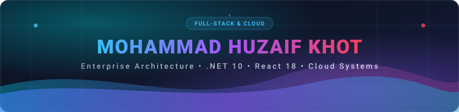

<!-- High Resolution Native SVG Banner -->

 

<!-- Dynamic Typing Subtitle -->

  
  
  

---

### 💻 Developer Environment

  

---

### 🏛️ Architecture & Systems Showcase

<table>
  <tr>
    <td width="50%" valign="top">
      <h4>⚡ Enterprise Workflow & Orchestration</h4>
      
Architecting multi-tenant, event-driven workflow platforms with 4-Eye authorization principles, auditable event sourcing, and CQRS patterns.

      <ul>
        <li><b>Backend:</b> .NET 10, MediatR, FluentValidation, Entity Framework Core</li>
        <li><b>Database:</b> Multi-schema isolation, Azure PostgreSQL Flexible Server</li>
        <li><b>Patterns:</b> Clean Architecture, CQRS, Domain-Driven Design</li>
      </ul>
    </td>
    <td width="50%" valign="top">
      <h4>🖥️ High-Conversion & Modular Frontends</h4>
      
Building high-performance, modular frontend applications utilizing menu-slice architectures and strictly typed design systems.

      <ul>
        <li><b>Stack:</b> React 18, TypeScript, Vite, Tailwind CSS</li>
        <li><b>State & UI:</b> Modular Sub-panels, Lucide React, Strict Component Boundaries</li>
        <li><b>Enterprise:</b> SharePoint Framework (SPFx) & Enterprise Integrations</li>
      </ul>
    </td>
  </tr>
  <tr>
    <td width="50%" valign="top">
      <h4>☁️ Cloud Infrastructure & DevOps</h4>
      
Automating zero-downtime deployments, containerization, and secure cloud environments.

      <ul>
        <li><b>Cloud:</b> Microsoft Azure, Azure Key Vault, Managed PostgreSQL</li>
        <li><b>Containers:</b> Docker multi-stage builds, Container Hosting</li>
        <li><b>CI/CD:</b> GitHub Actions automated validation & deployment pipelines</li>
      </ul>
    </td>
    <td width="50%" valign="top">
      <h4>🔒 Security, Compliance & Governance</h4>
      
Enforcing rigorous access controls, auditability, and zero-trust engineering standards.

      <ul>
        <li><b>Security:</b> JWT Authentication, RBAC, Dual-Custody Approval Logic</li>
        <li><b>Reliability:</b> Deterministic unit & integration testing, structured logging</li>
        <li><b>Standards:</b> OWASP best practices & regulatory audit trails</li>
      </ul>
    </td>
  </tr>
</table>

---

### 🛠️ Tech Stack & Ecosystem

#### Backend & Core Architecture

  
  
  
  
  
  

#### Frontend & Client Engineering

  
  
  
  
  
  

#### Cloud, DevOps & Databases

  
  
  
  
  

---

### 🌐 Connect & Collaborate

  
  
  

 

  

